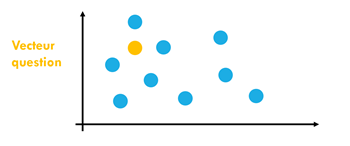

# Retrieval-Augmented Generation (RAG)

## A- Définition
Le **Retrieval-Augmented Generation (RAG)** est une architecture combinant un modèle de langage (LLM) et un système de récupération d'informations. Le LLM génère des réponses en s'appuyant uniquement sur les documents fournis, sans utiliser de connaissances externes.

---

## B- Fonctionnement

### 1. Ingestion du document
- **Chargement** : Importation du document dans le système.
- **Découpage (chunking)** : Division du texte en segments (chunks) de taille définie.
- **Vectorisation** : Transformation de chaque segment en vecteur numérique via un modèle d'embedding (ex : BERT, Sentence-BERT).  
  
    

- **Stockage** : Enregistrement des vecteurs dans une base de données vectorielle (ex : FAISS, Pinecone).

### 2. Retrieval (Récupération)
- **Vectorisation de la question** : 
Conversion de la question utilisateur en vecteur.  
    
      

- **Recherche de similarité** : Comparaison du vecteur de la question avec ceux des segments du document.
- **Sélection des segments** : Extraction des k segments les plus proches (par défaut, k = 4).  
  
      

- **Génération de la réponse** : Le LLM utilise ces segments pour produire une réponse contextuelle.  
  
    

---

## C- Problèmes de la non exhaustivité

La non-exhaustivité d'une réponse est une réponse qui n'est pas complète malgré que toutes les informations étaient présentes dans le document original. 
J'ai divisé ces problèmes en 3 catégories : 

### 1. Performance du retrieval
- **Proximité vectorielle** :   
En général, un document traite d'un sujet (ex : chantier BTP), donc toues les segments de textes partagent des thèmes communs.
Ce qui veut dire que tous les vecteurs seront plus ou moins proches.  
Un vecteur sur un segment "risque de chantier" ne sera pas très éloigné de "retard de chantier".  
- **Conséquence** : Les segments pertinents peuvent être classés au-delà des *k* premiers (ex : 5ᵉ ou 10ᵉ position).   
Si seuls les 4 premiers sont envoyés au LLM, des informations clés sont omises.  

### 2. Limite du nombre de segments
- **Dépendance à *k*** :   
Par défaut, k = 4, donc on retrouve les 4 vecteurs les plus proches de la question.  
Ensuite, les 4 segments de texte correspondant à ces vecteurs sont envoyés au LLM.  
Mais si l'information du texte pouvant donner la réponse a été découpée en plus de 4 segments de texte,  
(disons 6) même si le retrieval retrouve 4 sur les 6, le LLM n'aura pas l'information des 2 autres segments de texte.
Et donc, il y a une possibilité de pertes d'informations.  

### 3. Découpage (chunking)
- **Hétérogénéité thématique** : La découpe du texte en segment est "non maîtrisée" dans le sens où elle peut intervenir au milieu d'un mot, d'un paragraphe,...  
suivant la méthode de chunking.      
Un segment peut contenir plusieurs paragraphes ou sujets différents.      
Par exemple, imaginez une découpe qui se fait juste avant la fin du chapitre 5 sur les pénalités.    
ce segment contiendra certainement aussi le début du chapitre suivant, disons chapitre 6 sur la sécurité.  
  - **Cas 1** : Si 85 % du segment traite de la sécurité, son vecteur sera biaisé vers ce thème. Une question sur les pénalités aura peu de chances de le récupérer.    
  - **Cas 2** : Si le segment est équilibré (50 %/50 %), son vecteur sera intermédiaire, réduisant sa pertinence pour les deux thèmes.    

## C- Solution proposée
Ma solution tente de palier aux problèmes précédents.  

### 1. Maîtrise du chunking
Le texte est divisé en chapitre, puis chaque chapitre est segmenté.  
Chaque segment ne comportera qu'un seul "chapitre principal" mais pourra contenir plusieurs "sous-chapitre".  
Chaque segment est tagué par le numéro de son chapitre (= ajout de metadata)  

### 2. Retrieval large
k=12, on récupère les 12 premiers vecteurs les plus proches de la question.  
On récupère tous les numeros des chapitres de ces 12 vecteurs.  

### 3. Reranking.
On récupère tous les segments (on veut être exhausitif, ne pas rater la moindre information), de tous les chapitres trouvés dans le retrieval.   
Tous les segments et la question sont ensuites envoyés à un LLM qui va les reclasser, en leur donnant une note d'importance et en éliminant les segments inutiles.  

### 4. Génération de la réponse
Les segments retrouvés sont envoyés au LLM pour générer la réponse.

N.B. :
- La solution proposée a principalement été testée sur des documents de marché du BTP. (CCTP, CCAG,...)   
- Ces documents comporte une table des matières. (au début du document)  
- L'exhaustivité est la prorité principale. (et non le coût ou la performance).  
- Le nombre de chapitre est de l'ordre de la 15 en moyenne.  
- Le nombre de chapitre envoyés au reranking est de l'ordre de 5 ou 6.   
(dans les 12 segments retrouvés, plusieurs ont le même numéro de chapitre)  
