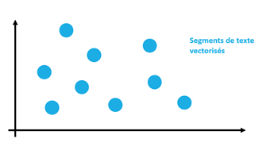
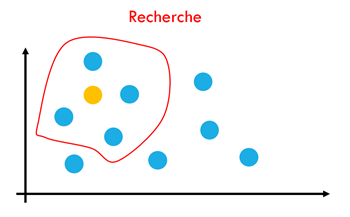

# Retrieval-Augmented Generation (RAG)

## A- Definition
**Retrieval-Augmented Generation (RAG)** is an architecture that combines a language model (LLM) with an information retrieval system. The LLM answers using only the documents it is given, without relying on external knowledge.

---

## B- How it works

### 1. Document ingestion
- **Loading**: the document is imported into the system.
- **Chunking**: the text is split into segments (chunks) of a fixed size.
- **Embedding**: each chunk is turned into a numeric vector by an embedding model (e.g. BERT, Sentence-BERT).

    

- **Storage**: the vectors are saved in a vector database (e.g. FAISS, Pinecone).

### 2. Retrieval
- **Question embedding**: the user question is converted into a vector.

    

- **Similarity search**: the question vector is compared with the chunk vectors.
- **Chunk selection**: the k closest chunks are extracted (k = 4 by default).

    

- **Answer generation**: the LLM uses these chunks to produce a contextual answer.

    

---

## C- The non-exhaustiveness problem

A non-exhaustive answer is an incomplete answer, even though all the information was present in the original document.
I split the causes into 3 categories.

### 1. Retrieval performance
- **Vector proximity**:
A document usually covers one subject (e.g. a construction site), so all its chunks share common themes.
This means all the vectors are more or less close to each other.
The vector of a "site risk" chunk will not be far from a "site delay" chunk.
- **Consequence**: relevant chunks can rank beyond the top *k* (5th or 10th position).
If only the first 4 are sent to the LLM, key information is left out.

### 2. Limit on the number of chunks
- **Dependence on *k***:
By default k = 4, so the 4 vectors closest to the question are retrieved.
The 4 matching text chunks are then sent to the LLM.
But if the information needed for the answer was split across more than 4 chunks (say 6),
even if retrieval finds 4 of the 6, the LLM will not see the other 2.
So information can be lost.

### 3. Chunking
- **Thematic heterogeneity**: splitting the text is "uncontrolled": a cut can fall in the middle of a word or a paragraph, depending on the chunking method.
A chunk can contain several paragraphs or topics.
For example, imagine a cut just before the end of chapter 5 on penalties.
That chunk will most likely also contain the start of the next chapter, say chapter 6 on safety.
  - **Case 1**: if 85% of the chunk is about safety, its vector is biased towards that theme. A question about penalties is unlikely to retrieve it.
  - **Case 2**: if the chunk is balanced (50%/50%), its vector sits in between, which lowers its relevance for both themes.

## D- Proposed solution
My solution tries to address the problems above.

### 1. Controlled chunking
The text is split into chapters, then each chapter is split into chunks.
Each chunk belongs to a single "main chapter" but can contain several "sub-chapters".
Each chunk is tagged with its chapter number (metadata).

### 2. Wide retrieval
k = 12: the 12 vectors closest to the question are retrieved.
The chapter numbers of these 12 vectors are collected.

### 3. Reranking
All the chunks of all the chapters found during retrieval are collected (the goal is to be exhaustive and not miss any information).
All these chunks and the question are then sent to an LLM that reranks them, giving each an importance score and discarding useless chunks.

### 4. Answer generation
The remaining chunks are sent to the LLM to generate the answer.

Notes:
- The solution was mainly tested on French construction market documents (CCTP, CCAG, ...).
- These documents have a table of contents at the start.
- Exhaustiveness is the main priority (not cost or speed).
- There are about 15 chapters on average.
- About 5 or 6 chapters are sent to reranking
(among the 12 retrieved chunks, several share the same chapter number).
