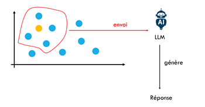

# Retrieval-Augmented Generation (RAG)

## A- Définition
Le **Retrieval-Augmented Generation (RAG)** est une architecture combinant un modèle de langage (LLM) et un système de récupération d'informations. Le LLM génère des réponses en s'appuyant uniquement sur les documents fournis, sans utiliser de connaissances externes.

---

## B- Fonctionnement

### 1. Ingestion du document
- **Chargement** : Importation du document dans le système.
- **Découpage (chunking)** : Division du texte en segments (chunks) de taille définie.
- **Vectorisation** : Transformation de chaque segment en vecteur numérique via un modèle d'embedding (ex : BERT, Sentence-BERT).  
  
    

- **Stockage** : Enregistrement des vecteurs dans une base de données vectorielle (ex : FAISS, Pinecone).

### 2. Retrieval (Récupération)
- **Vectorisation de la question** : 
Conversion de la question utilisateur en vecteur.  
    
      

- **Recherche de similarité** : Comparaison du vecteur de la question avec ceux des segments du document.
- **Sélection des segments** : Extraction des k segments les plus proches (par défaut, k = 4).  
  
      

- **Génération de la réponse** : Le LLM utilise ces segments pour produire une réponse contextuelle.  
  
    

---

## C- Problèmes de la non exhaustivité

La non-exhaustivité d'une réponse est une réponse qui n'est pas complète malgrés que toutes les informations étaient présentes dans le document original. 

### 1. Performance du retrieval
- **Contexte global** : Si le document traite d'un sujet large (ex : chantier BTP), les segments partagent des thèmes communs.
- **Proximité vectorielle** : Les vecteurs deviennent similaires, réduisant la précision de la recherche.
- **Conséquence** : Les segments pertinents peuvent être classés au-delà des *k* premiers (ex : 5ᵉ ou 10ᵉ position). Si seuls les 4 premiers sont envoyés au LLM, des informations clés sont omises.

### 2. Limite du nombre de segments
- **Dépendance à *k*** : Si la réponse nécessite plus de *k* segments (ex : 6), même avec un retrieval parfait, le LLM manque des données.

### 3. Découpage (chunking)
- **Hétérogénéité thématique** : Un segment peut mélanger plusieurs sujets (ex : fin du chapitre 5 sur les pénalités + début du chapitre 6 sur la sécurité).
  - **Cas 1** : Si 85 % du segment traite de la sécurité, son vecteur sera biaisé vers ce thème. Une question sur les pénalités aura peu de chances de le récupérer.
  - **Cas 2** : Si le segment est équilibré (50 %/50 %), son vecteur sera intermédiaire, réduisant sa pertinence pour les deux thèmes.
